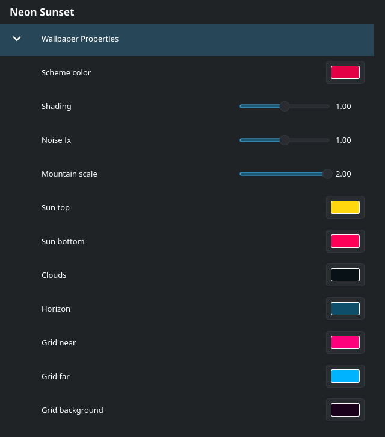

# Wallpaper Engine for KDE (scene text fork)

This is my personal fork of [catsout's Wallpaper Engine plugin for KDE](https://github.com/catsout/wallpaper-engine-kde-plugin).
It lets Plasma 6 play your Wallpaper Engine wallpapers straight from your Steam library.

I started it because the clock on a black hole wallpaper I liked just wouldn't show up.
One thing led to another, and now a lot more of Wallpaper Engine's scene features work.
The renderer and the plugin live together in this one repo, so there's only one thing to build.

The original project has moved on to [waywallen](https://github.com/waywallen/waywallen).
The old README, with install notes for other distros, is still here as [OLD-README.md](./OLD-README.md).


## What's new compared to upstream

### Clocks, dates and other text

Text layers in scene wallpapers now render, including the little scripts that keep them updated.
So clocks tick, dates change at midnight, and the "FRIDAY 23 OCT" on the black hole finally shows up.
Fonts come from the wallpaper when it ships one, and from your system otherwise.

| | |
|---|---|
|  |  |

### The wallpaper's own options

Most wallpapers come with settings their author added: colors, sliders, toggles, "show the clock or not".
Those now get their own **Wallpaper Properties** tab, next to Wallpapers and Settings.
Pick a wallpaper, open the tab, and change whatever you like. Hit Apply and the wallpaper updates right away.



### 3D scenes

Wallpapers built from 3D models used to come up blank or broken. Now you get:

- the models, with their lighting and normal maps
- floor reflections
- the slow camera moves the author recorded
- bloom (the soft glow around bright things)
- particles placed in the 3D scene, like Neon Sunset's stars

| | |
|---|---|
|  |  |
|  |  |

### Music visualizers

Wallpapers that react to audio get the spectrum of whatever your system is playing.
You don't have to set up anything.


### Smaller things

- Leaner GPU uploads: only the bytes that changed get sent each frame, and vertices use compact formats.
- Newer `.tex` texture versions (TEXB0004) load. Some recent workshop wallpapers crashed on these before.
- Fixes for a few crashes and rendering bugs that were already in the original plugin.

## Installing (Arch / CachyOS)

You need Wallpaper Engine installed through Steam; the plugin reads wallpapers and assets from there.
You also need a Vulkan driver.

```sh
git clone https://github.com/buntington/wallpaper-engine-kde-plugin.git
cd wallpaper-engine-kde-plugin/pkg/arch
makepkg -si
systemctl --user restart plasma-plasmashell
```

This installs as `plasma6-wallpapers-wallpaper-engine-scenetext`. It replaces the regular package if you had that installed.
After that, right-click the desktop, open **Configure Desktop and Wallpaper**, and pick **Wallpaper Engine for Kde** as the wallpaper type.

To update later, `git pull` and run the same `makepkg -si` and restart again.

For other distros, the dependency lists in [OLD-README.md](./OLD-README.md) still apply. Build with CMake as described there.

## What still doesn't work

I've tested against the 26 scene wallpapers I have downloaded, and they all render.
A few things are still missing:

- Shadows in 3D scenes (`_rt_shadowAtlas`), so some 3D wallpapers look a little flatter than in Wallpaper Engine.
- HDR bloom. Scenes that use it get the regular bloom instead.
- Camera fades between camera paths. The camera cuts to the next path instead.
- Web wallpapers work as they did upstream. None of the above applies to them.

If a wallpaper misbehaves, the log usually says why:
`journalctl --user -b | grep -i wescene`

## Developing

`devtest/` has scripts that render a wallpaper in its own window using the build in `stage/`, so you don't have to restart Plasma for every change.
`devtest/sweep.sh` renders a whole list of wallpapers and writes out screenshots and logs.
I use that to check nothing broke.

## License

GPL-2.0, same as upstream. See [LICENSE](./LICENSE).
