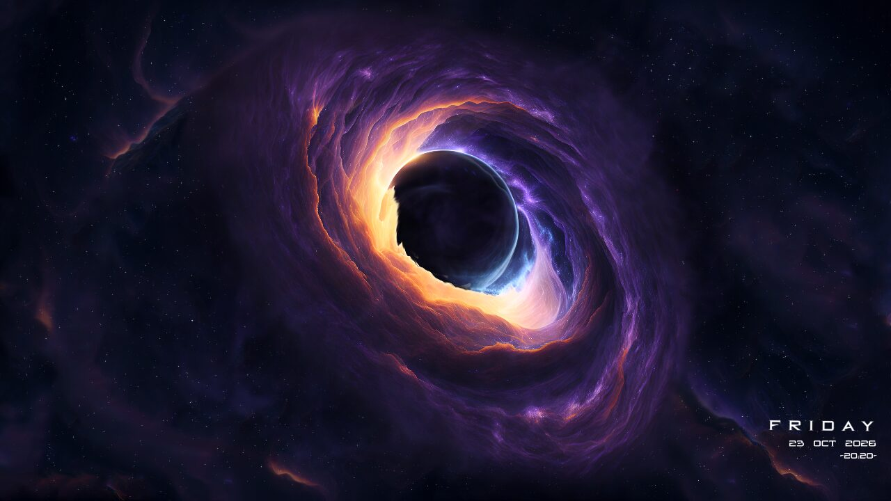
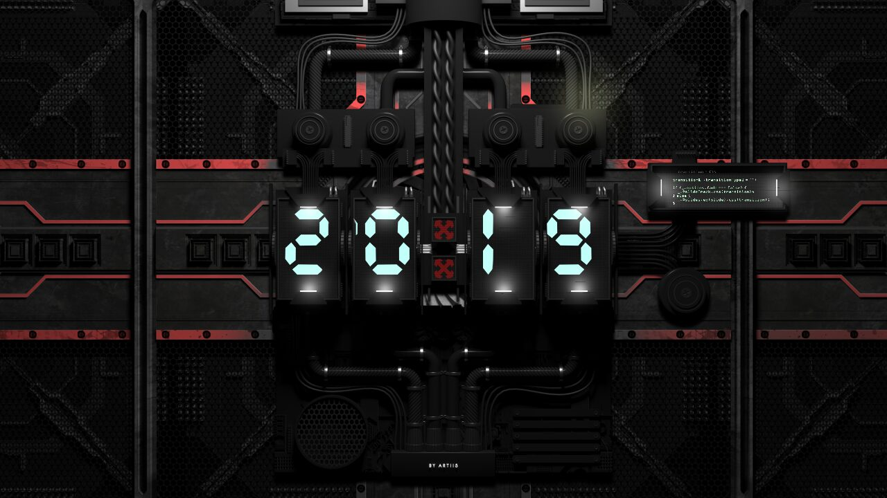
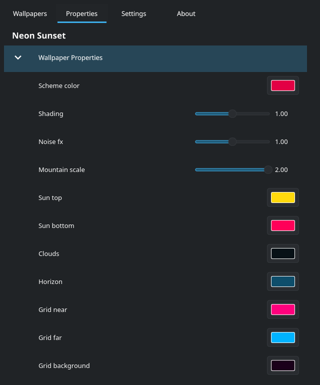

# Wallpaper Engine for KDE

This is a fork of [catsout's Wallpaper Engine plugin for KDE](https://github.com/catsout/wallpaper-engine-kde-plugin) that aims to restore as many of the features of wallpaper engine as possible in Linux.

This fork supports text layers and 3d scenes with a updated Vulkan implementation.

The original project has moved on to [waywallen](https://github.com/waywallen/waywallen).
The old README, with install notes for other distros, is still here as [OLD-README.md](./OLD-README.md).


## What's new compared to upstream

### Clocks, dates and other text

Text layers in scene wallpapers now render, including the little scripts that keep them updated.
So clocks tick, dates change at midnight, and the "FRIDAY 23 OCT" on the black hole finally shows up.
Fonts come from the wallpaper when it ships one, and from your system otherwise.

| | |
|---|---|
|  |  |

### The wallpaper's own options

Most wallpapers come with settings their author added: colors, sliders, toggles, "show the clock or not".
Those now get their own **Properties** tab, right next to Wallpapers.
Pick a wallpaper, open the tab, and change whatever you like. Hit Apply and the wallpaper updates right away.



### 3D scenes

Wallpapers built from 3D models are supported in this implementation with these features:

- the models, with their lighting and normal maps
- floor reflections
- the slow camera moves the author recorded, with the fade between shots if the wallpaper asks for it
- bloom (the soft glow around bright things), including the HDR kind newer wallpapers use
- particles placed in the 3D scene, like Neon Sunset's stars

| | |
|---|---|
|  |  |
|  |  |

### Music visualizers

Wallpapers that react to audio get the spectrum of whatever your system is playing using Mini-audio.


### Smaller things

- Leaner GPU uploads: only the bytes that changed get sent each frame, and vertices use compact formats.
- Newer `.tex` texture versions (TEXB0004) load. Some recent workshop wallpapers crashed on these before.
- Fixes for a few crashes and rendering bugs that were already in the original plugin.

## Installing (Arch / CachyOS)

You need Wallpaper Engine installed through Steam; the plugin reads wallpapers and assets from there.
You also need a Vulkan driver.

```sh
git clone https://github.com/buntington/wallpaper-engine-kde-plugin.git
cd wallpaper-engine-kde-plugin/pkg/arch
makepkg -si
systemctl --user restart plasma-plasmashell
```

This installs as `plasma6-wallpapers-wallpaper-engine-scenetext`. It replaces the regular package if you had that installed.
After that, right-click the desktop, open **Configure Desktop and Wallpaper**, and pick **Wallpaper Engine for Kde** as the wallpaper type.

To update later, `git pull` and run the same `makepkg -si` and restart again.

For other distros, the dependency lists in [OLD-README.md](./OLD-README.md) still apply. Build with CMake as described there.

## What still doesn't work

I've tested against the 26 scene wallpapers I have downloaded, and they all render, but your mileage may vary.
A few things are still missing or rough:

- Lights that cast shadows. None of my wallpapers use them (every light has `castshadow` off), so I couldn't test it and left it out.
- HDR bloom runs on 8-bit buffers. Real HDR keeps colors brighter than white and blooms those; here they're clipped to white first, so HDR glows (Razer Bedroom's neon, for example) come out softer than in Wallpaper Engine.
- Web wallpapers work as they did previously.

If a wallpaper misbehaves, the log usually says why:
`journalctl --user -b -t plasmashell | grep ERROR`

## Developing

`devtest/` has scripts that render a wallpaper with the build in `stage/`, so you don't have to restart Plasma for every change.
`devtest/sweep.sh` renders a whole list of wallpapers in a hidden KWin session and writes out screenshots and logs.
I use that to check nothing broke.

## License

GPL-2.0, same as upstream. See [LICENSE](./LICENSE).
